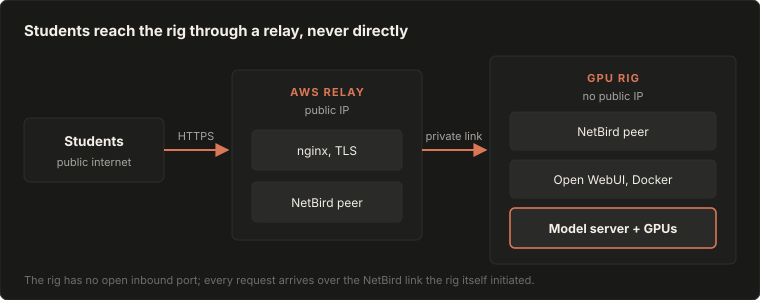

# Public gateway playbook: exposing a GPU rig behind a locked-down network

This playbook documents how to expose a self-hosted LLM, running on GPU hardware behind a locked-down network, to the public internet through a real domain with a working chat interface. It was built and proven against a district-managed network that blocks common tunneling tools by port and by DNS, so the path described here is intentionally more resilient than a simple port-forward or tunnel setup.

The short version: a small relay server with a public IP sits between the internet and the GPU rig. The relay and the rig are joined to the same private overlay network (NetBird), so the rig never needs a public IP or an open inbound port of its own. The relay terminates TLS and reverse-proxies requests over the private link to a containerized chat interface (Open WebUI) running on the rig, which talks to the model server.

**Who this is for:** anyone standing up the same kind of public LLM gateway on hardware that sits behind a network they do not fully control, particularly one that actively blocks the obvious tools.

> [!NOTE]
> Written 2026-09-30 and re-rendered on 2026-10-16 in the [standard playbook format](../../docs/conventions.md#playbooks). The wording is unchanged and the diagram was redrawn. This is a general how-to. For how OCS Intelligence runs today, see [status](../../docs/status.md) and the [network](../../docs/architecture/network.md) doc.

## Architecture



The rig never opens an inbound port. It reaches out to NetBird itself, the same way it does for ordinary SSH access, so nothing about this exposure path looks unusual to a network filtering by port or by known tunneling signatures.

## Prerequisites

| Item | What you need | Notes |
|---|---|---|
| Domain | A registered domain with DNS you can edit | Any registrar works; DNS can stay wherever it already lives, it does not need to move to any particular provider |
| Relay server | A small cloud VM with a public IP | AWS EC2 t3.micro or t3.small is plenty; this box does no compute, it only relays traffic |
| GPU rig | Ubuntu with NVIDIA drivers and CUDA installed, GPU verified with `nvidia-smi` | The model-serving steps assume this is already working |
| NetBird account | A free NetBird account | Used to create the private overlay network between the relay and the rig |
| SSH access | Working SSH into both the relay and the rig | Needed for every step below |
| Docker | Installed on the rig | Used to run the chat interface container |

## What we did

### Step 1: Join the relay and the rig to a private overlay network

This is the step that makes everything else possible. Once both machines are on the same NetBird network, the relay can reach the rig without the rig ever opening a port to the public internet.

1. Create a free account at netbird.io if you do not already have one.
2. Install NetBird on the GPU rig:

   ```bash
   curl -fsSL https://pkgs.netbird.io/install.sh | sh
   sudo netbird up
   ```

   This prints a login URL. Open it in any browser and approve the login, it authorizes this specific machine, not the browser you used.

3. Install NetBird on the relay server the same way:

   ```bash
   curl -fsSL https://pkgs.netbird.io/install.sh | sh
   sudo netbird up
   ```

4. Confirm both machines show as connected peers:

   ```bash
   sudo netbird status
   ```

5. Note the rig's NetBird IP address from the output, or from the NetBird dashboard's Peers list. It looks like `100.x.x.x`. Every later step that talks to the rig from the relay uses this address.

### Step 2: Set up the relay server

The relay is the only machine in this whole setup that needs a public IP. Everything on it exists to terminate TLS and forward traffic privately to the rig, it does no inference and needs almost no resources, a t3.micro is genuinely enough.

#### 2a. Launch the instance

1. In the AWS Console, go to EC2, then Instances, then click Launch Instance.
2. Under Name, enter something identifiable like `gateway-relay`.
3. Under Application and OS Images, choose the Ubuntu Quick Start option and select Ubuntu Server 24.04 LTS. If the pre-selected AMI ID shows an error about not being valid for this region, use the dropdown next to it to pick a current one, or search Ubuntu Server 24.04 LTS directly in the catalog search box.
4. Under Instance type, choose t3.micro.
5. Under Key pair, click Create new key pair. Name it, leave the type as RSA and the format as `.pem`, then click Create key pair. This downloads a `.pem` file, this is what you SSH in with, keep it, AWS will not let you download it again.

   > [!TIP]
   > If you do not have a way to use that downloaded key, or you are working from a browser with no local terminal, you do not need one. After the instance launches, select it in the Instances list, click Connect, then the EC2 Instance Connect tab, then Connect. This opens a working terminal directly in your browser using temporary AWS-managed credentials, no key file required.

6. Under Network settings, click Edit. An SSH rule on port 22 is included by default. Add two more rules:

   | Type | Protocol | Port | Source |
   |---|---|---|---|
   | SSH | TCP | 22 | Your IP, or Anywhere if you are not sure you have a static IP |
   | HTTP | TCP | 80 | Anywhere |
   | HTTPS | TCP | 443 | Anywhere |

   HTTP and HTTPS genuinely need to be open to anywhere, that is the entire point, the public needs to reach this box on those ports.

7. Leave storage at its default, 8GB is plenty for a box doing nothing but relaying traffic.
8. Click Launch instance. Wait roughly a minute for it to reach the Running state.

#### 2b. Give it a stable address

A plain public IP on an EC2 instance can change if the instance ever stops and restarts. Before anything depends on this box's address, allocate an Elastic IP so it never moves:

1. In the EC2 sidebar, go to Elastic IPs, then Allocate Elastic IP address, then Allocate.
2. Select the new address, click Actions, then Associate Elastic IP address, and pick this instance.

From here on, use this Elastic IP, not the original auto-assigned public IP, everywhere in this playbook, including the DNS record in Step 3.

#### 2c. Install the reverse proxy

SSH into the relay, either with the key you downloaded or through the EC2 Instance Connect browser terminal, then:

```bash
sudo apt update
sudo apt install nginx certbot python3-certbot-nginx -y
```

Confirm it is running:

```bash
sudo systemctl status nginx
```

If this box already hosts another site, this is completely fine and does not need to be touched. Check what is already configured before changing anything:

```bash
ls /etc/nginx/sites-enabled/
```

Everything in this playbook adds a new, separate config file for this gateway's own subdomain, covered in Step 6, it never edits or replaces anything already listed there.

### Step 3: Point a domain at the relay

1. Find the relay's public IP:

   ```bash
   curl -4 ifconfig.me
   ```

2. In your DNS provider, add an A record for the subdomain you want, pointing at that IP:

   ```text
   Name:  gateway  (or whatever subdomain you want)
   Type:  A
   Value: <relay public IP>
   ```

3. Wait a minute or two, then confirm it resolved:

   ```bash
   dig +short gateway.yourdomain.com
   ```

   It should print back the same IP from step 1. Do not continue to the next step until this matches.

### Step 4: Serve the model on the rig

1. Install Ollama, or build llama.cpp if you want direct control over serving flags. Either works with the rest of this playbook.
2. Make sure the model server listens on more than just the rig's own loopback address. By default, Ollama only accepts connections from itself, which silently blocks every external proxy no matter how correctly it is configured.

   For Ollama, set this through a systemd override rather than editing how it starts:

   ```bash
   sudo mkdir -p /etc/systemd/system/ollama.service.d
   sudo tee /etc/systemd/system/ollama.service.d/override.conf << 'EOF'
   [Service]
   Environment="OLLAMA_HOST=0.0.0.0"
   EOF
   sudo systemctl daemon-reload
   sudo systemctl restart ollama
   ```

3. Confirm it is actually listening broadly, not just to itself:

   ```bash
   sudo ss -tlnp | grep 11434
   ```

   This should show `0.0.0.0:11434`, not `127.0.0.1:11434`.

4. Confirm the model responds:

   ```bash
   curl http://localhost:11434/api/tags
   ```

   This should return real JSON listing your installed model. If it does not, stop here and fix this before moving on, nothing downstream will work until this does.

### Step 5: Deploy the chat interface

1. Install Docker on the rig if it is not already there:

   ```bash
   curl -fsSL https://get.docker.com -o get-docker.sh
   sudo sh get-docker.sh
   ```

2. Run Open WebUI, pointed at the model server on the rig's own host, not the container's internal localhost:

   ```bash
   docker run -d -p 3000:8080 \
     -e OLLAMA_BASE_URL=http://host.docker.internal:11434 \
     --add-host=host.docker.internal:host-gateway \
     -v open-webui:/app/backend/data \
     --name open-webui \
     --restart always \
     ghcr.io/open-webui/open-webui:main
   ```

   > [!IMPORTANT]
   > The `--add-host` flag is not optional. Inside a container, `localhost` refers to the container itself, not the machine it is running on, so without this flag Open WebUI cannot see Ollama even though both are running correctly.

3. Confirm it responds locally:

   ```bash
   curl -I http://localhost:3000
   ```

   Give it a minute or two on first run, it downloads an embedding model in the background before it is fully ready.

### Step 6: Wire nginx to the chat interface

On the relay, create a dedicated config file for this gateway, separate from any other site nginx already serves:

```bash
sudo tee /etc/nginx/sites-available/gateway << 'EOF'
server {
    listen 80;
    listen [::]:80;
    server_name gateway.yourdomain.com;
    return 301 https://$host$request_uri;
}
server {
    listen 443 ssl;
    listen [::]:443 ssl;
    server_name gateway.yourdomain.com;
    location / {
        proxy_pass http://RIG_NETBIRD_IP:3000;
        proxy_set_header Host $host;
        proxy_set_header X-Real-IP $remote_addr;
        proxy_http_version 1.1;
        proxy_set_header Upgrade $http_upgrade;
        proxy_set_header Connection $connection_upgrade;
        proxy_buffering off;
        proxy_read_timeout 300s;
    }
}
EOF
```

Replace `RIG_NETBIRD_IP` with the address from Step 1, and `gateway.yourdomain.com` with your actual subdomain.

The `Upgrade` and `Connection` headers are required for the chat interface's WebSocket connections. Without them, the interface loads but silently breaks on features that depend on a live connection.

Add the connection-upgrade map nginx needs for those headers to work:

```bash
sudo tee /etc/nginx/conf.d/websocket-upgrade.conf << 'EOF'
map $http_upgrade $connection_upgrade {
    default upgrade;
    ''      close;
}
EOF
```

Enable the site, get a certificate, and reload:

```bash
sudo ln -s /etc/nginx/sites-available/gateway /etc/nginx/sites-enabled/
sudo certbot --nginx -d gateway.yourdomain.com
sudo nginx -t
sudo systemctl reload nginx
```

Visit `https://gateway.yourdomain.com` in a browser. You should land on the chat interface's account creation screen. The first account created becomes the admin automatically.

### Step 7: Lock it down

By default the gateway is open to anyone who finds the link. Before sharing it widely:

1. In the chat interface, go to Admin Panel, then Settings, then General, and turn off Enable New Sign Ups. This stops random visitors from creating their own accounts.
2. Add accounts for real users from Admin Panel, Users, Add User, or briefly re-enable sign-ups for a fixed window and have people register themselves, then turn it back off.
3. Add rate limiting in nginx so no single user or script can saturate the GPU:

   ```nginx
   limit_req_zone $binary_remote_addr zone=gateway:10m rate=10r/m;

   location / {
       limit_req zone=gateway burst=5 nodelay;
       # ...existing proxy_pass and headers from Step 6
   }
   ```

4. If you are also exposing the raw model API directly, separate from the chat interface, put an API key check in front of it. The chat interface's own account system does not cover a raw API endpoint.

## Pitfalls

These are real failures hit while building this exact setup, kept here so nobody has to rediscover them.

| Symptom | Root cause | Fix |
|---|---|---|
| A tunneling tool times out connecting, no useful error | The network blocks a specific outbound port that tool needs | Test with that tool's own connectivity check first; if blocked, do not try a different tunneling brand, they tend to share the same fate on a network built to filter them, use the NetBird plus relay approach in this playbook instead |
| DNS resolves a hostname to a private address like `10.x.x.x` | Local DNS is sinkholing that specific hostname | Query an outside DNS server directly; if that also fails, the network is blocking port 53 to outside resolvers entirely, use DNS over HTTPS on port 443 instead |
| 403 Forbidden on every proxied request, even though the tunnel itself works | Ollama validates the Host header and rejects anything that is not localhost, as protection against DNS rebinding attacks | Rewrite the Host header back to localhost at the proxy layer, or set `OLLAMA_HOST` broadly and accept the security tradeoff |
| Chat interface shows no models available, despite the model server running fine | Inside a Docker container, `localhost` refers to the container itself, not the host machine | Use `host.docker.internal` with the add-host flag shown in Step 5 |
| Chat interface loads but features relying on a live connection silently fail | Missing WebSocket upgrade headers in the reverse proxy | Add the `Upgrade` and `Connection` headers and the connection-upgrade map shown in Step 6 |
| Docker container shows unhealthy right after starting | First boot downloads an embedding model in the background; this is not a crash | Wait a minute or two and retest, or check `docker logs` before assuming it failed |
| A private overlay network tool shows 0 connected peers even though it is running | Some overlay tools use lazy connection, meaning they do not establish a link to a peer until something actually tries to reach it | Make a request to the peer first, then recheck status |

## Glossary

| Term | Meaning |
|---|---|
| Relay | The small public-facing server that sits between the internet and the private rig |
| Overlay network | A private network layered on top of the public internet, so machines on it can reach each other directly regardless of what firewalls sit between them |
| Reverse proxy | A server that receives public requests and forwards them to another server, without the original server being directly reachable |
| Host header rebinding protection | A security check that rejects requests unless they claim to come from the local machine, meant to stop a malicious webpage from tricking a browser into attacking services on your own network |
| WebSocket | A persistent, two-way connection between a browser and a server, used for live features like streamed responses |
| GGUF | A file format for storing quantized model weights, used by llama.cpp and Ollama |

## Sources

- The original PDF of 2026-09-30, replaced by this re-render
- Why NetBird and a relay instead of a tunnel: [decision 0004](../../docs/decisions/0004-netbird-over-cloudflare-ngrok.md) and [network](../../docs/architecture/network.md#the-district-network)
