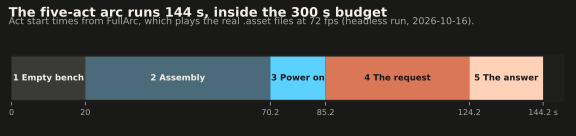
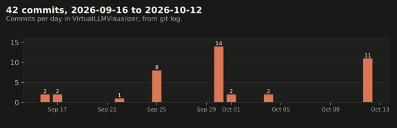
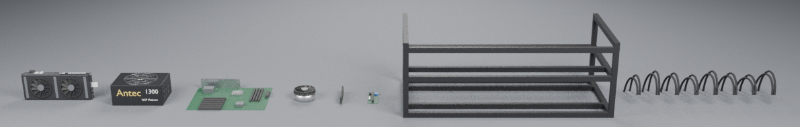
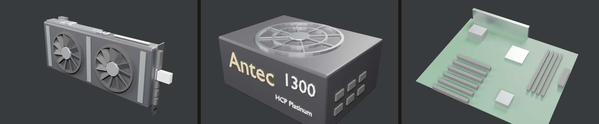
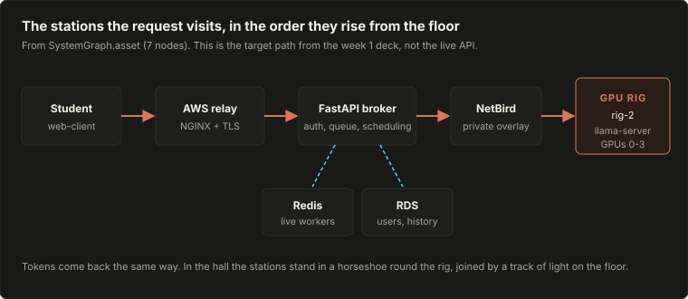
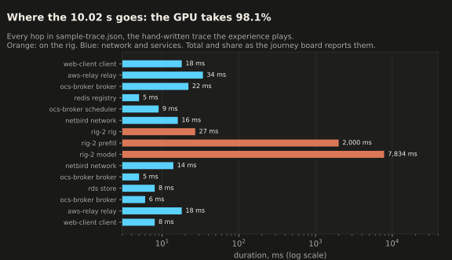
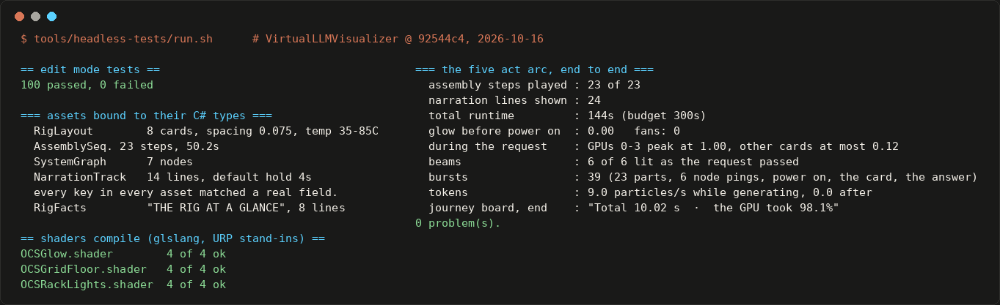
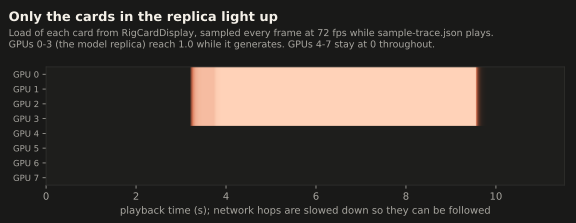

# The VR experience of the OCS LLM path

Sprint 2 built the VR layer of OCS Intelligence. In a Meta Quest headset, the viewer watches a GPU rig assemble itself, power on, and serve one inference request. The request travels from a student's desk through the system and lands on specific cards in front of them. The code is in [`YashPatil321/VirtualLLMVisualizer`](https://github.com/YashPatil321/VirtualLLMVisualizer): 42 commits from 2026-09-16 to 2026-10-12. On 2026-10-16 the whole experience ran end to end in a headless simulation. 100 of 100 tests passed and the arc took 144 s, inside the 300 s budget. It has **not** been run on a headset yet, so frame rate and the outside-viewer test are still open.

## At a glance

| | |
|---|---|
| Goal | Five minutes in a headset that show what happens when a prompt is sent to our system |
| Outcome | The experience, scene builder, Quest setup and rig models are complete. The full arc passes in simulation (2026-10-16). Not yet run on a Quest |
| Where | [`VirtualLLMVisualizer`](https://github.com/YashPatil321/VirtualLLMVisualizer), commit `92544c4`. Unity 6000.6.1f1, URP, Android ARM64, IL2CPP, OpenXR |
| Why | Most people's picture of an LLM stops at a text box. This shows the rest of it |
| Proof | Every artifact is in [`assets/`](./assets/). Each one is listed, with how it was made, under [Sources](#sources) |



| Act | Starts | What the viewer sees |
|---|---:|---|
| 1. Empty bench | 0.0 s | A bare two-level black frame and a tray of parts, in a dark data hall |
| 2. Assembly | 20.0 s | 23 parts fly in on arcs, in Rig 2's real build order. Each part is labelled with its name and one fact as it seats |
| 3. Power on | 70.2 s | The cards power on in a ripple, the fans spin up, and a shockwave crosses the floor and wakes the server racks |
| 4. The request | 85.2 s | The stations rise out of the floor around the rig. A pulse carries the prompt along a floor track, and each station's sign says what happened there and how long it took |
| 5. The answer | 124.2 s | GPUs 0–3 go to full load, tokens stream to the student's screen, and the answer types out. It then runs back along the track |
| End | 144.2 s | The scene holds, and the viewer can walk the stations |

## Before

At the start of Sprint 2, the VR layer was a design document and a hand-written trace format. There was no Unity project, no rig model and no scene, so there was nothing to show anyone. The first draft of the request path also included a Mac Mini, which is not part of the system.

## What we did



1. **Telemetry and data layers first** (2026-09-16 to 09-17). Plain C# classes load the trace, sort the hops by time, validate them, and play them back as events. The data lives in ScriptableObjects, not code: the build order, the card layout, the stations and the narration. Playback logic never touches a Transform, so every rule can be tested without a scene.

2. **One-click scene builder** (2026-09-25). OCS > Build Experience Scene builds the whole scene from the data. It uses the real models when they are present, and placeholders otherwise.

3. **Rig 2 modelled as it really is** (2026-09-25 to 09-30). [`tools/blender/generate_rig_parts.py`](https://github.com/YashPatil321/VirtualLLMVisualizer/blob/claude/nifty-cannon-b34hkf/tools/blender/generate_rig_parts.py) builds 8 parts at real size, modelled on photos of Rig 2: EVGA GTX 1070 SC cards, a two-level black frame and two Antec HCP 1300 W supplies. The whole rig is about 26,000 triangles, cheap enough for a Quest 2 with every card on screen. The FBX files are committed to the repo, so no Git LFS is needed. Rendered on 2026-10-16 from that script, with Blender 4.0.2:

   

   

   ```text
   [rig parts] gpu_card      1716 tris  40 x 267 x 111 mm
   [rig parts] psu           2164 tris  200 x 150 x 86 mm
   [rig parts] motherboard    192 tris  305 x 244 x 2 mm
   [rig parts] cpu_cooler     692 tris  90 x 90 x 45 mm
   [rig parts] ram_stick      132 tris  7 x 133 x 31 mm
   [rig parts] riser          132 tris  40 x 100 x 2 mm
   [rig parts] frame          216 tris  800 x 400 x 300 mm
   [rig parts] pcie_cables   2304 tris  559 x 185 x 126 mm
   ```

4. **Removed the Mac Mini, and matched the VR to the week 1 architecture** (2026-09-30 to 10-01). The stations now follow the deck's target path:

   

5. **Built the look within Quest 2 limits** (2026-09-30). There are no realtime shadows, no post-processing and no dynamic lights. All the glow comes from three unlit, Single Pass Instanced shaders: `OCSGlow` for halos, beams, sparks and tokens, `OCSGridFloor` for the floor, the shockwave and the ripples, and `OCSRackLights` for a whole rack face of blinking lights on one quad.

6. **Made it informative** (2026-10-01). Every part carries a fact line, and every station shows its role. Two boards stand in the hall: "The rig at a glance" and "How a request flows". The second lights each hop as the request reaches it, then shows the total and the GPU's share. Those numbers come from the trace:

   

7. **Quest setup** (2026-10-04 to 10-12). The project has a head-tracked camera, plus an OCS > Quest menu that sets up URP, installs the XR packages, applies the build settings and checks the setup. The OpenXR loader, the Android build profile and the rebuilt `Experience.unity` were committed on 2026-10-12 (commit `9881af6`, 84 files).

8. **Walking and controls** (2026-10-12). The left stick walks, the right stick turns and rises, holding the right trigger runs time at 4×, and the left menu button starts over. In the editor, the same controls are WASD, the arrow keys, F and R.

> [!NOTE]
> The request shown is a hand-written trace of the **target** path from the week 1 deck, not a recording from the live API. Network hops are slowed down so the viewer can follow them, and the GPU part plays in real time. The boards show the real durations from the trace.

## How to check it

**Without Unity.** Run on 2026-10-16 on commit `92544c4`, with Mono C# 6.8.0.105 and glslang 11:15.1.0. The full output is [`assets/headless-run-2026-10-16.log`](./assets/headless-run-2026-10-16.log).

```bash
git clone https://github.com/YashPatil321/VirtualLLMVisualizer
cd VirtualLLMVisualizer
sudo apt-get install -y mono-mcs glslang-tools
tools/headless-tests/run.sh
```



The arc also has to light the right cards. [`assets/CardSweep.cs`](./assets/CardSweep.cs) drives the project's own `TracePlayer` and `RigCardDisplay` frame by frame and records every card's load ([`card-load-2026-10-16.csv`](./assets/card-load-2026-10-16.csv), 2,808 frames):



This run proves four things: the code compiles, every field in every `.asset` file matches a real C# field, the right cards light and no others, and the shaders' HLSL is valid. It says nothing about frame rate, comfort, or whether the build runs on a Quest.

**On a Quest.** The full order is in [`docs/demo-checklist.md`](https://github.com/YashPatil321/VirtualLLMVisualizer/blob/claude/nifty-cannon-b34hkf/docs/demo-checklist.md).

| Check | Pass looks like | If it fails |
|---|---|---|
| OCS > Quest > 0. Set Up URP for Quest | "URP is active on every quality level" | Everything magenta: no URP asset active |
| Delete `Assets/Prefabs/Environment.prefab`, then OCS > Build Experience Scene | "23 parts from Assets/Art/Models" | An old room prefab replaced the data hall |
| Press Play | The arc runs in about 2.5 min. Nothing magenta, no mirrored text | Take a screenshot and copy the Console |
| OCS > Quest > 1, 2, then Check Setup | Every line says ok | Fix the red line |
| XR Plug-in Management, Android tab | OpenXR, Meta Quest Support, Single Pass Instanced, Oculus Touch Controller Profile | Without the Touch profile, the sticks do nothing |
| Build And Run to a Quest 2 over USB | The app starts in the headset by itself | `adb devices` shows unauthorized: accept USB debugging in the headset |
| Meta performance overlay through power on and token streaming | 72 fps throughout | Reduce, in order: fewer racks, less dust, then fog off |
| Three runs from a cold start | The same result each time | Note what changed between runs |

## Pitfalls

| Symptom | Cause | Fix |
|---|---|---|
| Everything magenta except text | No URP pipeline asset is active (`Assets/Settings/` is missing or not assigned) | OCS > Quest > 0, or copy `Assets/Settings/` with its `.meta` files |
| Unity opens in Safe Mode and editor commands fail with nothing useful | A C# compile error | Fix the first Console error, then restart Unity |
| The old room appears after a rebuild | A hand-saved `Environment.prefab` replaces the generated hall | Delete it before OCS > Build Experience Scene |
| A red Console message about an older builder | The scene was built by an earlier version of the builder | Rebuild the scene |
| An `.asset` field silently does nothing | A field name typo; Unity ignores unknown keys | `tools/headless-tests/run.sh` flags it |
| Black screen in the headset | OpenXR not enabled under the Android tab | XR Plug-in Management, Android, OpenXR |
| The sticks and buttons do nothing | No Oculus Touch Controller Profile | Add it under OpenXR interaction profiles |
| Two editors fight over `ProjectVersion.txt` | Different Unity versions | Everyone uses 6000.6.1f1 |
| Blender stops with `No module named 'numpy'` | The distro Blender uses the system Python | `apt-get install python3-numpy` (seen 2026-10-16) |
| Blender stops with `Build without OpenImageDenoiser` | Denoising is on in a build that lacks it | Set `cycles.use_denoising = False`, as the script's own preview does |

## Open items

This playbook stays `in progress` until these are closed.

- **No headset proof yet.** Nothing in this playbook was captured on a Quest, and no screenshot or photo of the experience running exists. Closing this needs a run on a Quest 2, recorded as a new capture in `evidence/captures/`. The capture should include:
  - a screenshot or clip from the headset (Meta Quest Developer Hub can record the view);
  - the frame rate from the performance overlay, through the power-on wave and while tokens stream;
  - the results of three cold starts.

  That run would close milestones V1 and V2.
- **Outside-viewer test (V6).** Three people not on the team should be able to explain afterwards what the rigs do and where the model runs. If they can't, rewrite the narration and test again.
- **Power-on audio cue (V4).** Not added yet.
- **Real art (V7).** Cable routing, baked normal maps and texture atlases are not done.
- **The VR shows the target path, not the live one.** Since 2026-10-15 the live system differs from the VR:

  | VR shows | Live, as of the [Sprint 4 playbook](../sprint4/2026-10-15-inference-on-both-rigs.md) |
  |---|---|
  | A broker with Redis and RDS | EC2 Nginx → admission gateway → orchestrator → llama.cpp worker. There is no broker, Redis or RDS |
  | `rig-2` running Qwen3.8 27B on GPUs 0–3 (4 cards is an assumption in `gpu_count`) | Rig 2 serves `qwen3.6:35b-a3b` on all 8 GPUs, through Open WebUI only |
  | About 12 tokens/s (deck figure) | Rig 2 about 27 tok/s on the MoE model. Rig 1 Worker A about 8.7 tok/s |
  | Eight EVGA GTX 1070 SC cards | Rig 2's GPU 0 is an 11 GB 1080 Ti (`TENSOR_SPLIT=11,8,...`) |

  All of these are data (`sample-trace.json`, `SystemGraph.asset`, `RigFacts.asset`), not code. The real fix is a recorded trace: once the gateway or orchestrator logs the fields in the VR's [metrics contract](https://github.com/YashPatil321/VirtualLLMVisualizer/blob/claude/nifty-cannon-b34hkf/docs/metrics-contract.md), a captured request can replace the hand-written one.
- **Live mode (V8, optional).** Not started, by design. It needs a read-only trace endpoint.

## Sources

**Code and docs**
- [`VirtualLLMVisualizer`](https://github.com/YashPatil321/VirtualLLMVisualizer), branch `claude/nifty-cannon-b34hkf`, commits `5fec212` (2026-09-16) to `92544c4` (2026-10-12)
- In that repo: `docs/experience-design.md`, `docs/milestones.md`, `docs/demo-checklist.md`, `docs/setup-runbook.md`, `docs/metrics-contract.md`
- [Inference on both rigs](../sprint4/2026-10-15-inference-on-both-rigs.md), for the live state of Rig 2

**Artifacts in [`assets/`](./assets/), all made on 2026-10-16 from commit `92544c4`**

| Artifact | What it proves | How it was made |
|---|---|---|
| [`headless-run-2026-10-16.log`](./assets/headless-run-2026-10-16.log), [`.png`](./assets/headless-run-2026-10-16.png) | Tests, asset binding, the full arc, shaders | `tools/headless-tests/run.sh`, verbatim (compiler warnings and absolute paths removed). The PNG shows the key lines, with the 12 shader lines summed per shader |
| [`card-load-2026-10-16.csv`](./assets/card-load-2026-10-16.csv), [`card-load.svg`](./assets/card-load.svg) | Only GPUs 0–3 light up | [`CardSweep.cs`](./assets/CardSweep.cs), compiled against the repo's scripts and `tools/headless-tests/UnityShim.cs`, run on `sample-trace.json` |
| [`arc-timeline.svg`](./assets/arc-timeline.svg) | Act timings and the 144 s total | The act start times in the log above |
| [`request-hops.svg`](./assets/request-hops.svg) | Where the time goes | `Assets/Data/sample-trace.json` |
| [`request-path.svg`](./assets/request-path.svg) | The stations and their order | `Assets/Data/SystemGraph.asset` |
| [`commit-history.svg`](./assets/commit-history.svg) | When the work happened | `git log --date=short` in the VR repo |
| [`rig-parts-lineup.png`](./assets/rig-parts-lineup.png) | The 8 rig models exist, at real size | `blender -b --factory-startup --python tools/blender/generate_rig_parts.py -- --out <dir> --preview <png>`, Blender 4.0.2, cropped |
| [`rig-parts-closeups.png`](./assets/rig-parts-closeups.png) | What the card, PSU and board look like | [`render_closeups.py`](./assets/render_closeups.py), which runs the same generator and renders one part per Blender run |
| Charts | — | [`make_charts.py`](./assets/make_charts.py) (matplotlib 3.11) |
