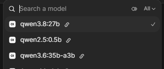

# Inference on both rigs, behind one chat

Sprint 4's goal is inference on both rigs, offered through one provider. The first half is done. Rig 2's worker was crash-looping until 2026-10-15, when we fixed it, gave Rig 2 its own orchestrator, and moved it to a faster mixture-of-experts model. We then connected Open WebUI to it as a second connection. On 2026-10-16 the model picker at `https://ai.opencodingsociety.com/` showed all three models to a regular user. The top two are served by Rig 1 and the bottom one by Rig 2. The second half is still open: the two rigs aren't yet behind **one** API. Open WebUI holds two separate connections, and the Rig 2 path skips the EC2 wait line.

## At a glance

| | |
|---|---|
| Goal | Both rigs serve inference through one provider |
| Done so far | Both rigs serve. One Open WebUI shows all three models; users pick a model, not a rig |
| Still open | One router that knows both rigs, so the public `/v1` API and Open WebUI both see one provider |
| Where | Rig 2 (`100.75.127.192`): worker, orchestrator. Rig 1: Open WebUI container. NetBird: `rigs-to-rigs` |
| Why | [Decision 0009](../../docs/decisions/0009-rig2-moe-behind-open-webui.md), **proposed** |



| Model | Rig | Path from Open WebUI | Generation, one request |
|---|---|---|---|
| `qwen3.8:27b` | Rig 1, Worker A (5 GPUs) | connection 0: EC2 gateway → wait line → Rig 1 orchestrator | ~8.7 tok/s |
| `qwen2.5:0.5b` | Rig 1, Worker B (2 GPUs) | connection 0: same path | ~80–97 tok/s |
| `qwen3.6:35b-a3b` | Rig 2, all 8 GPUs | connection 1: straight to Rig 2's orchestrator over NetBird | ~27 tok/s |

Speeds come from single requests ([Rig 1 log](../captures/2026-09-18-rig1-deployment-log.md), [Rig 2 record](../captures/2026-10-15-rig2-inference-fix.md)). They aren't benchmarks.

## Before

Rig 2 came back from the [Sprint 3 rebuild](../../docs/project/roadmap.md#sprints) with [`infra/rig2/setup.sh`](../../infra/rig2/setup.sh) already run: CUDA 12.6, llama.cpp, the model, and `ocs-llama.service` were all in place. But it served nothing:

| Check | What we saw |
|---|---|
| `ocs-llama.service` | Crash-looping, restart counter at **4,531** |
| Worker log | `couldn't bind HTTP server socket, hostname: 127.0.0.1, port: 8081` |
| What held `:8081` | A placeholder `python3 -m http.server 8081 --bind 0.0.0.0`, started from a desktop terminal for a planned `ai2.opencodingsociety.com` page |
| GPU memory | 7 MiB per card: no model loaded |

The plan at the time was a separate public site for Rig 2. The team decided against it: there should be **one** Open WebUI, with a router choosing the rig.

## What we did

All of this was done over NetBird SSH from an `outbound-only` operator peer ([NetBird playbook](./2026-10-15-netbird-one-way-access.md)).

1. **Free the port and restart the worker.** We killed the placeholder (its folder was left in place) and ran `systemctl restart ocs-llama`. The worker was healthy about 2 minutes later, serving `qwen3.8:27b` at **8.8 tok/s**. That's the same speed as Rig 1's Worker A, with 8 GPUs instead of 5.

2. **Give Rig 2 its own orchestrator.** We deployed this repo's `orchestrator/` to `/opt/ocs-orchestrator/`, with Worker B made optional (Rig 2 runs one worker). Unlike Rig 1, Rig 2 can reach PyPI, so the venv came from PyPI. Config: [`infra/rig2/orchestrator.env.template`](../../infra/rig2/orchestrator.env.template) and [`infra/rig2/ocs-orchestrator.service`](../../infra/rig2/ocs-orchestrator.service).

   ```text
   /readyz                                  {"status":"ready"}
   /v1/models, wrong key                    401
   /v1/chat/completions model=qwen2.5:0.5b  404
   ```

3. **Switch Rig 2 to a mixture-of-experts model.** Every card is on a PCIe gen 1 ×1 riser, and layer split runs one GPU at a time, so more GPUs add memory, not speed. A dense model reads all of its weights for every token. **Qwen3.6-35B-A3B** activates only ~3B of its 35B parameters per token. We downloaded Unsloth's `UD-Q4_K_XL` GGUF (22.4 GB, SHA-256 checked against Hugging Face) and changed `worker.env`:

   ```bash
   DEFAULT_MODEL_ID=qwen3.6:35b-a3b
   TENSOR_SPLIT=11,8,8,8,8,8,8,8   # GPU 0 is the 11 GB 1080 Ti
   PARALLEL=2
   CONTEXT_SIZE=524288             # 2 slots x the model's full 262,144 tokens
   LLAMA_EXTRA_ARGS=-ub 1024
   ```

   Generation went from 8.8 to **27.2 tok/s**. This config was picked without benchmarking, at the team's request.

4. **Let the rigs talk.** Open WebUI runs on Rig 1, so it needs Rig 2's `:9000`. We added the temporary `rigs-to-rigs` NetBird policy (commit `c2ac00d`).

5. **Add Rig 2 to Open WebUI as a second connection.** We generated a dedicated key for Open WebUI → Rig 2 and appended it to Rig 2's `PUBLIC_API_KEYS`. We backed up Open WebUI's database (`webui.db.bak-20261015`), added connection 1, `http://100.75.127.192:9000/v1`, and restarted the container. From inside the container, both connections listed their models, and a chat through connection 1 ran at 27.8 tok/s.

6. **Check it in a browser** (2026-10-16). Signed in as a regular user, the picker shows `qwen3.8:27b`, `qwen2.5:0.5b`, and `qwen3.6:35b-a3b` (screenshot above).

> [!IMPORTANT]
> Open WebUI 0.11.3 merges the model lists of its connections, but if two connections offer the **same model ID** it keeps only the first. That's why Rig 2 serves a *different* model instead of a second copy of `qwen3.8:27b`: two rigs with the same model name would never share load through Open WebUI.

## How to check it

| Check | Pass looks like | If it fails |
|---|---|---|
| Model picker on `https://ai.opencodingsociety.com/`, as a regular user | Three models, as in the screenshot | Only two: connection 1 is off, or Rig 2's orchestrator is down |
| On Rig 2: `systemctl is-active ocs-llama ocs-orchestrator` | `active` twice | `journalctl -u <unit> -n 80`. Check whether something else holds `:8081` (`ss -tlnp`) |
| On Rig 2: `curl -s http://127.0.0.1:9000/readyz` | `{"status":"ready"}` | The worker is still loading (about 2 min) or has crashed |
| From the Rig 1 host: `nc -vz 100.75.127.192 9000` | `succeeded` | The `rigs-to-rigs` policy is missing: `python3 infra/netbird/apply.py check` |
| A short chat with `qwen3.6:35b-a3b` | An answer at about 27 tok/s | Empty `content` with a long `reasoning_content` means `max_tokens` ran out while the model was thinking |

## Pitfalls

| Symptom | Cause | Fix |
|---|---|---|
| Worker restart counter in the thousands, `couldn't bind ... 8081` | Another process (a test web server) held the port on `0.0.0.0` | `ss -tlnp \| grep 8081`, stop the other process. Keep test servers off worker ports |
| A second rig serving the same model never gets traffic in Open WebUI | Open WebUI keeps only the first connection that offers a model ID | Serve different model names, or put a router in front |
| Rig 2 orchestrator accepts any Bearer token | `PUBLIC_API_KEYS` left empty | Always set it. Rig 2 has a temporary operator key and the Open WebUI key, not the student key |
| First chat after a restart returns a body without `choices` | Not captured. The next request worked | Retry once. If it repeats, capture the body |
| Short answers come back empty | The model thinks first; `max_tokens` spent on `reasoning_content` | Use a higher `max_tokens` |

## Open items

This playbook stays `in progress` until these are settled.

- **One provider.** Put a router that knows both rigs in front of them: EC2's gateway for now, the planned Mac Mini later. Then the public `/v1` API serves Rig 2's model too, Open WebUI goes back to one connection, and `rigs-to-rigs` can be removed ([roadmap](../../docs/project/roadmap.md#planned-not-built)).
- **Rig 2 skips the wait line.** Open WebUI → Rig 2 goes straight to the orchestrator. Only its reject threshold (16) and llama-server's 2 slots limit load.
- **Benchmark Rig 2's config** against alternatives (fewer GPUs, `PARALLEL`, `-ub`). A `llama-bench` run was started and interrupted before it printed anything.
- **Decide on 0009.** It's `proposed`. It also differs from the blueprint, which has Rig 2 as dev/test, not serving students.
- **Leftovers from the `ai2` attempt:** a TLS cert and Nginx site on EC2 (answering `301` to itself), and `/home/ocs/ai2-site` on Rig 2.
- **Rig 1's 8th GPU**, working since the [Sprint 3](../../docs/project/roadmap.md#sprints) rebuild, isn't used by either worker yet. Workers pin their GPUs by UUID.

## Sources

- [Rig 2: worker crash loop fixed, orchestrator deployed, switched to a MoE model](../captures/2026-10-15-rig2-inference-fix.md)
- [Open WebUI connected to Rig 2](../captures/2026-10-15-open-webui-rig2-connection.md)
- [Decision 0009](../../docs/decisions/0009-rig2-moe-behind-open-webui.md)
- Model picker screenshot: taken by the team on 2026-10-16, signed in as a regular user
- Commits `3319c30` (Rig 2 inference), `598b477` (Open WebUI connection), `952e972` (docs), `c2ac00d` (`rigs-to-rigs`)
