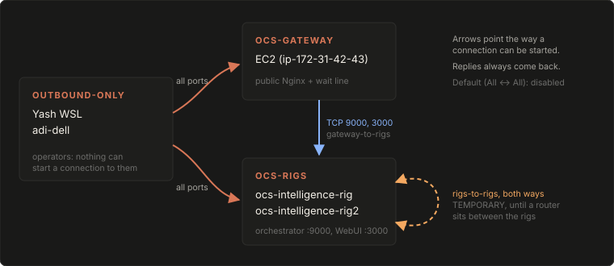

# Locking down NetBird with one-way group policies

On 2026-10-15 we replaced NetBird's built-in `Default` policy, which let every peer connect to every other peer in both directions, with three group-based policies. Operator machines now sit in an `outbound-only` group: they can reach every server, but nothing on the network can start a connection to them. The EC2 gateway reaches the rigs only on the two ports it needs. Later the same day a temporary `rigs-to-rigs` rule was added so Open WebUI on Rig 1 could call the model on Rig 2. That link is what the [Sprint 4 inference playbook](./2026-10-15-inference-on-both-rigs.md) depends on. The public API and operator SSH were checked before and after the change, and both kept working.

## At a glance

| | |
|---|---|
| Goal | No peer, including a compromised server, can open a connection to an operator's laptop or WSL |
| Outcome | Done. `Default` disabled; three one-way policies live; `apply.py check` matches `acl.json` |
| Where | The NetBird account (dashboard and management API). No host config changed |
| Desired state | [`infra/netbird/acl.json`](../../infra/netbird/acl.json), checked with [`infra/netbird/apply.py`](../../infra/netbird/apply.py) |
| Why | [Decision 0008](../../docs/decisions/0008-one-way-netbird-policies.md), **proposed**, awaiting a second operator's review |



## Before

NetBird holds both the servers (EC2, Rig 1, Rig 2) and operators' personal machines. Every peer was in the single group `All`, and these were the policies:

| Policy | Source → destination | Direction | Ports |
|---|---|---|---|
| `Default` | `All` → `All` | both ways | all |
| `SSH Access` (×3) | `All` → rig, rig2, EC2 | one-way | NetBird SSH 22 |
| Temporary access (×2) | a browser-client peer → rig | one-way | NetBird SSH 22022 |

`Default` was the only policy that let anything reach `Yash WSL` or `adi-dell`. Under it, a compromised rig could open connections into an operator's machine. The [threat model](../../docs/security/threat-model.md) also flagged that the rig's orchestrator port `9000` had no firewall rule, so every peer could reach it and skip the EC2 wait line.

## What we did

NetBird policies run from a source group to a destination group, and the client firewall is stateful. A one-way policy lets the source start connections and lets the replies come back, but the destination can't start a connection of its own. That property is what the whole design rests on.

1. **Write the desired state down first.** [`infra/netbird/acl.json`](../../infra/netbird/acl.json) lists the groups, their members, and the policies. `apply.py` only compares and creates. It never deletes, never edits an existing policy, and never changes group membership (that's done in the dashboard).

2. **Get an API token from an admin service user** and put it in the repo-root `.env`, which is gitignored:

   ```bash
   # .env  (template: .env.example)
   NETBIRD_API_TOKEN=nbp_CHANGE_ME
   ```

3. **Record the "before" state.** These checks were run from `Yash WSL`:

   ```text
   https://ai.opencodingsociety.com/healthz 200
   https://ai.opencodingsociety.com/ 200          # EC2 Nginx -> rig :3000 over NetBird
   WSL -> 100.75.123.203:9000 open
   WSL -> 100.75.123.203:22 open
   WSL -> 100.75.172.167:22 open
   ```

4. **Create the groups and policies**, still with `Default` on, so nothing breaks yet:

   ```bash
   python3 infra/netbird/apply.py check    # read-only: lists what's missing
   python3 infra/netbird/apply.py apply    # creates missing groups and policies
   ```

   | Group | Members |
   |---|---|
   | `outbound-only` | `Yash WSL`, `adi-dell` |
   | `ocs-gateway` | `ip-172-31-42-43` (EC2) |
   | `ocs-rigs` | `ocs-intelligence-rig`, `ocs-intelligence-rig2` |

   | Policy | Source → destination | Direction | Ports |
   |---|---|---|---|
   | `gateway-to-rigs` | `ocs-gateway` → `ocs-rigs` | one-way | TCP 9000, 3000 |
   | `outbound-only-to-infra` | `outbound-only` → `ocs-gateway`, `ocs-rigs` | one-way | all |

5. **Disable `Default`** (it's kept, not deleted, so it can be switched back on):

   ```bash
   python3 infra/netbird/apply.py default off     # "on" rolls back
   ```

6. **Re-run every check about 20 s later.** All the same results came back, plus `WSL -> 100.75.123.203:3000 open`. `netbird status -d` on `Yash WSL` then listed only the three servers. `adi-dell` and the browser-client peers had dropped out of its network map, as expected for two `outbound-only` peers.

7. **Amendment, same evening: `rigs-to-rigs`.** Open WebUI runs on Rig 1, and Sprint 4 needed it to call the model on Rig 2. We added a bidirectional `ocs-rigs` → `ocs-rigs` rule on all ports (commit `c2ac00d`). Restricting server-to-server traffic buys little here, because EC2, the most exposed host, already reaches both rigs. What 0008 protects is the `outbound-only` machines, and that rule didn't change.

> [!WARNING]
> `rigs-to-rigs` is **temporary**. Remove it from `acl.json` and the dashboard once a router (the planned Mac Mini, or EC2) sits between the rigs.

## How to check it

| Check | Pass looks like | If it fails |
|---|---|---|
| `python3 infra/netbird/apply.py check` | `live NetBird config matches acl.json` | Someone changed policies in the dashboard. Decide which side is right, then fix the other |
| `curl -s -o /dev/null -w '%{http_code}' https://ai.opencodingsociety.com/healthz` | `200` | EC2 Nginx or the gateway is down. That isn't NetBird |
| `curl -s -o /dev/null -w '%{http_code}' https://ai.opencodingsociety.com/` | `200` (EC2 → rig `:3000` over `gateway-to-rigs`) | Check that `gateway-to-rigs` is enabled and EC2 is in `ocs-gateway` |
| `nc -vz -w5 100.75.123.203 9000` from an operator machine | `open` | Your peer isn't in `outbound-only`: dashboard → Peers → your peer → Groups |
| `netbird status -d` on an operator machine | Lists only servers, not other operators | Another operator peer is in a group that a policy points at |
| `python3 -m pytest -q tests/test_netbird_acl.py` | Passes. It asserts no policy has `outbound-only` as a destination | Someone made `acl.json` unsafe |

## Pitfalls

| Symptom | Cause | Fix |
|---|---|---|
| `403 permission denied` when creating a group | The API token belonged to a service user with the `user` role, which can read but not write | Use a token from a service user with the **admin** role |
| A new operator can SSH in but can't reach `:9000` or `:3000` | New peers join no group. They only get the `SSH Access` policies, whose source is `All` | Add the peer to `outbound-only` in the dashboard |
| Open WebUI on Rig 1 can't reach Rig 2's `:9000` | There's no policy between two members of `ocs-rigs` unless one says so | `rigs-to-rigs` (temporary) |
| A new service across NetBird doesn't answer | The default is now deny | Add a rule to `acl.json`, run `apply`, and update [network](../../docs/architecture/network.md) |

## Open items

- **Second-operator review.** Blueprint §6 asks for two-person review of firewall changes. This change was applied live by one person, so [0008](../../docs/decisions/0008-one-way-netbird-policies.md) stays `proposed` until a second operator reviews `acl.json` and runs `apply.py check`.
- **Not checked yet: a connection from a server to an operator machine.** We expect it to time out. Checking it needs a shell on a rig or on EC2.
- **Not checked yet: dashboard browser SSH after the change.**
- **Not checked yet: `/v1/*` end to end under the new policy.** It uses the same EC2 → rig `:9000` path, which needs a student key. `/` exercises the same rule on `:3000`.
- **Remove `rigs-to-rigs`** once a router sits between the rigs ([roadmap](../../docs/project/roadmap.md#planned-not-built)).

## Sources

- [NetBird access policies: before and after](../captures/2026-10-15-netbird-access-policies.md), the verbatim checks
- [Decision 0008](../../docs/decisions/0008-one-way-netbird-policies.md) and its 2026-10-15 amendment
- [Network](../../docs/architecture/network.md#access-policies), the current group table
- Commits `b8d12e4` (lockdown, `infra/netbird/`, tests) and `c2ac00d` (`rigs-to-rigs`)
